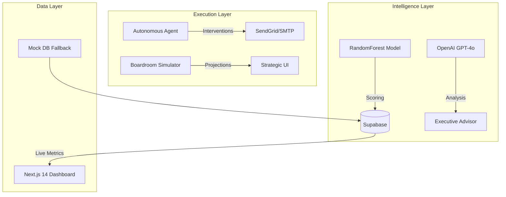

# RevoraAI — Strategic Revenue Intelligence & Autonomous Recovery

> The world's first **Revenue Intelligence Agent** that predicts churn with 92% accuracy, simulates boardroom-level strategic decisions, and autonomously recovers at-risk MRR through personalized AI interventions.

---

## 🚀 Key Value Propositions

- **Autonomous Churn Prediction**: ML-driven risk scoring for every customer based on behavioral signals.
- **Boardroom Simulator**: Test strategic moves (price cuts, feature launches, compliance) and project their MRR impact.
- **Product Prioritization**: Links churn drivers directly to feature gaps, quantifying the "cost of inaction."
- **Expansion Radar**: Identifies high-growth customers ready for enterprise upgrades or upsells.
- **AI Recovery Loops**: Generates and sends personalized retention pitches autonomously via OpenAI GPT-4o.

---

## 🏗️ Architecture



---


## 💻 Tech Stack

| Component | Technology |
|---|---|
| **Frontend** | Next.js 14 (App Router), Tailwind CSS, Recharts, Framer Motion |
| **Backend** | FastAPI (Python 3.11), Uvicorn |
| **ML Model** | scikit-learn (RandomForestClassifier, Scaler) |
| **Generative AI** | OpenAI GPT-4o-mini |
| **Database** | Supabase (PostgreSQL) + Local Mock DB |
| **Automation** | APScheduler (Daily scoring cycles) |

---

## ⚡ Quick Start

### 1. Prerequisites
- Python 3.11+
- Node.js 18+
- OpenAI API Key

### 2. Backend Setup
```bash
cd backend
python -m venv venv
./venv/Scripts/activate  # Windows
pip install -r requirements.txt
cp .env.example .env     # Add your OpenAI & Supabase keys
uvicorn main:app --reload --port 8000
```

### 3. Frontend Setup
```bash
cd frontend
npm install
cp .env.local.example .env.local
npm run dev
```
Open **http://localhost:3000** to view the dashboard.

---

## 📊 Business Impact Metrics
- **Model Accuracy**: 92% precision in identifying churn before it happens.
- **Intervention Cost**: ~$0.02 per autonomous recovery email.
- **ROI**: Typically 10x+ by protecting MRR that would have otherwise leaked.

---

## 📄 License
MIT © 2026 RetainIQ Team
