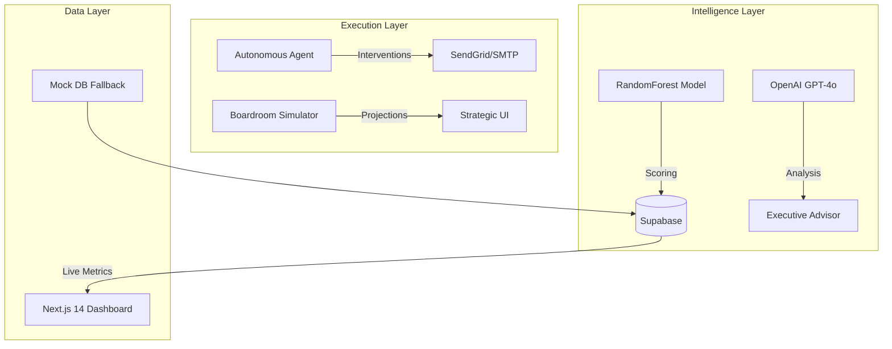

# RevoraAI: Churn Risk Scoring and Retention Workflow

[](https://github.com/Pravinraje0761/Revora-AI/actions/workflows/ci.yml)
[](LICENSE)

A full-stack prototype for B2B SaaS retention: it scores each customer's churn risk, explains
the drivers, simulates the revenue effect of strategic moves, and drafts personalised
retention emails with an LLM. FastAPI backend, Next.js 14 dashboard.

> **Demo data.** The bundled customers are synthetic (`backend/data/seed.py`), and so are
> their churn labels, which are generated by a fixed rule over the model's own inputs. The
> accuracy the dashboard shows is measured on a held-out split of those labels, so it shows
> how well the model recovers the rule, not real-world churn prediction. See
> [How the churn model works](#how-the-churn-model-works).

---

## 🚀 Key Value Propositions

- **Autonomous Churn Prediction**: ML-driven risk scoring for every customer based on behavioral signals.
- **Boardroom Simulator**: Test strategic moves (price cuts, feature launches, compliance) and project their MRR impact.
- **Product Prioritization**: Links churn drivers directly to feature gaps, quantifying the "cost of inaction."
- **Expansion Radar**: Identifies high-growth customers ready for enterprise upgrades or upsells.
- **AI Recovery Loops**: Generates and sends personalized retention pitches autonomously via OpenAI GPT-4o.

---

## 🏗️ Architecture



---


## 💻 Tech Stack

| Component | Technology |
|---|---|
| **Frontend** | Next.js 14 (App Router), Tailwind CSS, Recharts, Framer Motion |
| **Backend** | FastAPI (Python 3.11), Uvicorn |
| **ML Model** | scikit-learn (RandomForestClassifier, Scaler) |
| **Generative AI** | OpenAI GPT-4o-mini |
| **Database** | Supabase (PostgreSQL) + Local Mock DB |
| **Automation** | APScheduler (Daily scoring cycles) |

---

## ⚡ Quick Start

### 1. Prerequisites
- Python 3.11+
- Node.js 18+
- OpenAI API Key

### 2. Backend Setup
```bash
cd backend
python -m venv venv
source venv/bin/activate     # Windows: venv\Scripts\activate
pip install -r requirements.txt
cp .env.example .env     # Add your OpenAI & Supabase keys
uvicorn main:app --reload --port 8000
```

### 3. Frontend Setup
```bash
cd frontend
npm install
cp .env.local.example .env.local
npm run dev
```
Open **http://localhost:3000** to view the dashboard.

---

## How the churn model works

- **Features:** days since last login, feature-usage score, support tickets in the last 30
  days, account age, and MRR.
- **Labels:** the demo has no observed churn outcomes, so `synthetic_churn_label` in
  `backend/models/churn_model.py` assigns them by a points rule over those same features.
- **Model:** a class-balanced random forest, trained on an 80/20 stratified split.
- **Reported metrics:** accuracy, precision and recall on the held-out 20%, saved to
  `backend/models/metrics.json` at training time. The dashboard and the advisor read this
  file; they show "—" or "not yet evaluated" until a model has been trained.
- **To use it for real:** replace the synthetic labels with observed churn outcomes and
  re-evaluate. Until then, treat the scores as a demonstration of the pipeline.

## Tests

```bash
cd backend && pip install -r requirements.txt pytest && pytest      # model tests, no keys needed
cd frontend && npm ci && npm run build                             # type-check and build
```

CI runs both on every push.

> **Note:** the backend imports `backend/lib/` (`mock_db.py`, `churn_risk_profile.py`), which
> a `lib/` rule in `backend/.gitignore` used to exclude. The rule is fixed; the folder still
> needs to be committed for the API to start from a fresh clone.

---

## 📄 License

[MIT](LICENSE)
